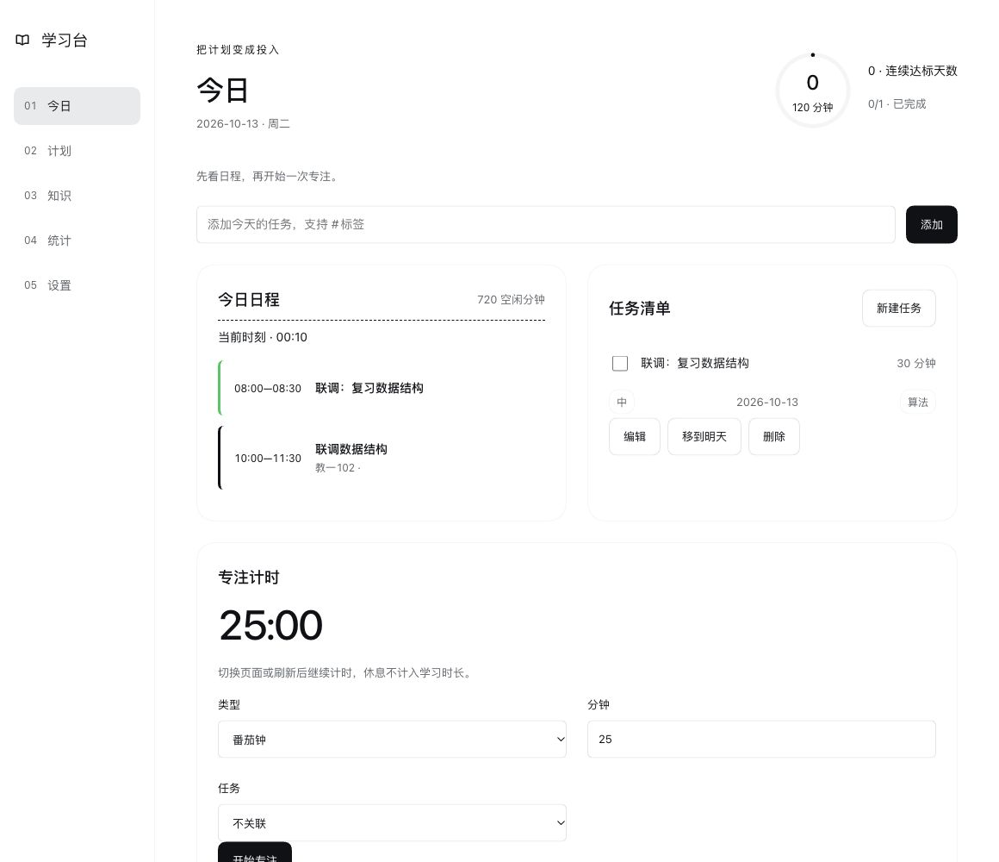

# 个人学习台

[English](README.md) | 中文

## 概述

个人学习台为 DeepSeek Harness Web GUI 增加五个分区：今日、计划、知识、统计和设置。把每周课表与任务合成日程，跨页保持专注计时，并把笔记做成间隔复习卡。学习数据保存在本机 DSH Host，可导出为 JSON。四个 Agent 工具读取和更新同一份数据。



## 目录

- [安装](#install)
- [使用学习台](#use-the-desk)
- [开发](#development)
- [实现](#implementation)
- [限制](#limitations)
- [许可](#license)

<a id="install"></a>

## 安装

使用已包含基础 bundle 和 Web app bundle 的 DSH Web profile。本插件面向 Web GUI，不提供原生 Desktop 面板。

1. 把插件添加到 Web profile：

   ```sh
   dsh plugin --profile web add github:2723191422-lab/-DeepSeek-Harness-
   ```

2. 安装提示 `restart-required` 时，重启该 profile：

   ```sh
   dsh --profile web --no-open --host 127.0.0.1 --port 19399
   ```

3. 打开 DSH 打印的启动链接，再点侧栏的**学习台**。先在**设置**中填写学期起始日，课程才会进入每日计划。

本地源码目录可用 `dsh plugin --profile web add ./dsh-learning-desk` 安装。安装直接使用已提交的 `client.js`，用户不需要构建工具。唯一运行时依赖是 `zod`。

<a id="use-the-desk"></a>

## 使用学习台

| 分区 | 可用操作 |
| --- | --- |
| 今日 | 用 `#标签` 快速添加任务，查看合成时间轴，移动或隐藏时间块，处理待排任务并开始专注 |
| 计划 | 添加课程、周次区间和单双周，预览粘贴的课表文本，导入或撤销一批课程，编辑任务和子任务 |
| 知识 | 搜索 Markdown 笔记及关联，管理卡片和卡组，用 1–4 键翻面后评分，收藏资源并记录阅读进度 |
| 统计 | 查看实际专注分钟、达标连续天数、任务完成率、课程和标签分布、12 周热力图及 30 天趋势，并下钻明细 |
| 设置 | 设置目标、计时预设、每日复习上限、学期与每周起始日，导出或用 JSON 替换学习数据 |

Host 持久保存计时的开始、暂停和继续状态。倒计时会在目标时长停止，休眠后也按目标截断；正计时持续到手动结束。已完成的专注按本地午夜分日，休息不计入学习时长和达标连续天数。

Agent 可调用 `learning_desk_today`、`learning_desk_add_task`、`learning_desk_plan_day` 和 `learning_desk_cards_from_note`。最后一个工具先返回笔记，Agent 再提交问答对进行保存。当前运行的 profile 必须加载插件，这些工具才可用。

导入或清空前先导出备份。替换导入先校验全部记录，再删除原有记录。多条写入过程中若存储失败，部分记录可能已保存：编辑会停止，界面提示结果不确定；必须重启 Host 并检查数据后再继续。

<a id="development"></a>

## 开发

使用 Node 24，在本仓库内部安装依赖；验收时不能让祖先目录的 `node_modules` 提供 `zod`。

```sh
npm ci --no-audit --no-fund
npm run build
npm run check
npm test
git diff --exit-code client.js
```

编辑 `src/ui/**` 后重新生成 `client.js`，不要手改生成物。确定性内联脚本支持的 ESM 子集见[运行架构](docs/runtime.zh.md)。CI 重新生成并拒绝差异。修改已加载的插件代码后需要重启 Host。

原有领域算法和八张表的存储 schema 仍是共享权威。测试覆盖 schema 与构造器对齐、导入校验、Host/工具/UI 共用数据、计时恢复、本地午夜、复习上限、取消以及过期轮询响应。详见[贡献说明](CONTRIBUTING.md)和[验证证据](docs/verification.md)。

<a id="implementation"></a>

## 实现

<details>
<summary>源码位置</summary>

| 路径 | 职责 |
| --- | --- |
| `index.js`, `src/host/` | 认证 HTTP 路由、四个工具、串行写入及计时和复习元数据 |
| `src/domain/`, `src/storage/` | 原有领域算法及 zod 校验的学习表 |
| `src/ui/` | React 视图、双语文案、宿主主题 CSS 与 Host 缓存 |
| `scripts/build-client.mjs`, `client.js` | 确定性开发生成器和已提交的浏览器模块 |
| `cordis.patch.yml`, `locale/`, `icon.svg` | profile 组合及插件管理页元数据 |
| `tests/`, `.github/workflows/ci.yml` | 无额外依赖的测试设施和干净 clone 检查 |

浏览器从宿主模块加载器取得 React，通过属主槽位贡献界面，不向浏览器存储写学习数据。详见[运行架构](docs/runtime.zh.md)和[升级指南](docs/upgrade-guide/v0.1.0/host-data/guide.zh.md)。

</details>

<a id="limitations"></a>

## 限制

课程使用同日时间范围；周网格显示 08:00–22:00，所有课程也可从列表访问。Markdown 显示为经过转义的原文。课表支持手动录入和粘贴文本，不支持表格文件或 OCR。没有跨设备同步、账号服务和后台通知服务。

JSON 导出包含八张学习表和设置；活动计时器和每日复习计数属于 Host 元数据，不在导出内。活动计时期间不能导入。旧浏览器备份保留供手动导出和导入，不会静默迁移。Host 停止期间到期的倒计时，会在重启后的下一次读取时记录。休眠恢复用注入时钟测试，未声称已验证笔记本实际休眠。

<a id="license"></a>

## 许可

[MIT](LICENSE)。
