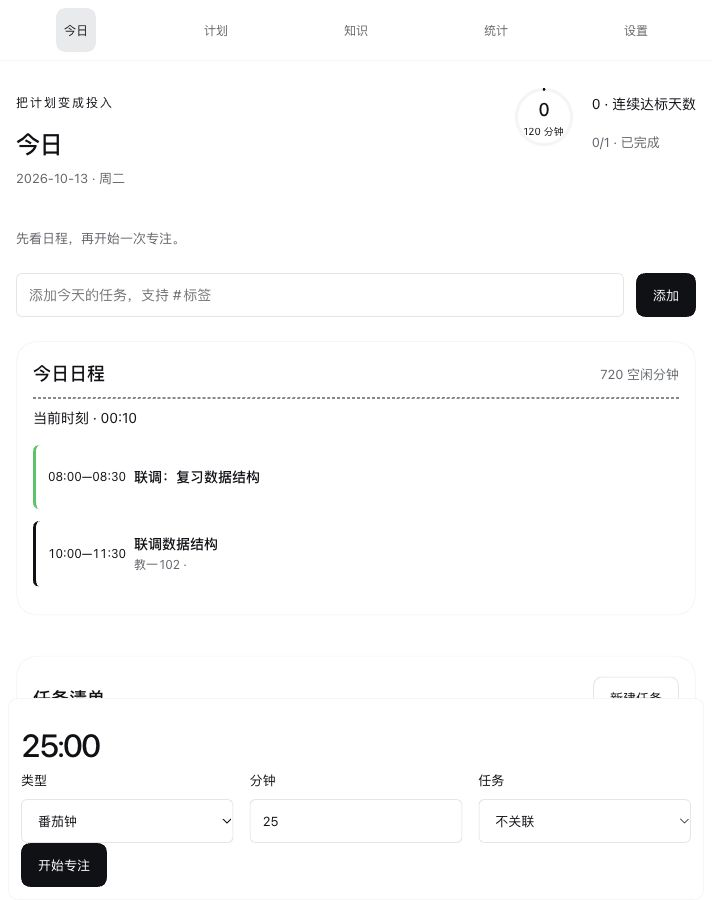
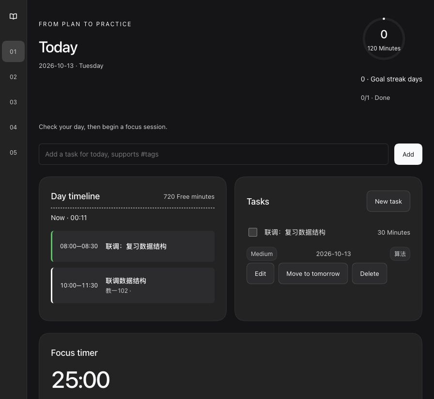

# 验证记录

2026-10-13，在 Node 24.15.0、macOS 和 DSH `0.2.1-alpha.2-d743267` 上执行。以下区分单测、真实浏览器、真实模型及安装；不把静态阅读当作运行结果。

| 验证 | 实际结果 |
| --- | --- |
| 原始基线 `node --test` | 79 passed / 0 failed |
| 当前 `npm test` | 112 passed / 0 failed / 0 skipped |
| `npm run check` | Host/Client 语法通过，8 项 manifest 检查通过，UI 导入、语义 token 和生成物同步检查通过 |
| `src/domain/**`、`src/storage/**` 差异 | 无修改 |
| 确定性构建及错误诊断 | 连续生成字节一致；不支持语法含文件与行号；对应 fixture 测试通过 |
| 双语文档 | README、运行架构、升级指南的结构、链接、物理行数和段落哈希对齐；用 Harness 双语 helper，以独立插件为 repoRoot 执行。外层仓库的完整文档门禁不覆盖本插件 docs |

## 真实宿主与浏览器

使用已有独立 Web profile `ldweb`，实际运行 `pnpm dsh --profile ldweb --no-open --host 127.0.0.1 --port 19399`，通过打印的本机认证启动链接打开。未向生产 Desktop profile 安装或更改 Harness 业务代码。

- 侧栏入口、五个分区均可用；新建课程、设置学期、课程进入今日时间轴已运行。
- 快速任务、标签、勾选完成、刷新后的完成态已检查。笔记 Markdown、标签及任务关系保存成功。
- 笔记制作复习卡、新卡组、翻面、四档按钮与数字 3 键评分已运行；复习后到期数减少。
- 资源收藏为阅读中，进度 35%；课表粘贴预览同时显示有效行及错误行，有效课程保存后进入时间轴。
- 开始专注、跨页显示、暂停、刷新恢复、继续及结束记录已运行；统计出现真实的本地跨日专注记录。
- 容器宽 1160px 显示 180px 文字导航；中档显示 56px 导航；712px 面板显示顶部导航、单列内容及底部常驻计时；所查主区域无横向溢出。
- 中英界面和插件管理页标题、描述都已检查；没有发现默认元数据回退。深色主题中主按钮和文字可见；浅色主按钮为白字 `rgb(255,255,255)` / 背景 `rgb(15,17,21)`。
- 弹窗 Esc 后没有打开的 dialog，焦点回到“新建任务”；知识 tabs 支持方向键，评分支持 1–4。

## 真实模型

DeepSeek-V4.1-Flash / High 在新建的“学习台插件四工具联调”会话实际完成 5 次调用：today、add_task、plan_day，以及 cards_from_note 的读取和保存。轨迹中五个结果的 `isError` 均为 false；新增任务随后在学习台页面可见。只使用本次创建的合成课程、任务和笔记。

[联调结果](agent-verification.md)已与本机工具事件核对。公开的 `tests/fixtures/synthetic-tools.json` 是另行生成的固定合成输入和输出，不取自模型会话；`tests/synthetic-tools.test.js` 无密钥重放并逐值比较结果和可读输出。真实会话事件与原始回答仅保留在本机。

## 验证范围

系统休眠和倒计时补记用注入时钟验证，没有让实体电脑进入睡眠。未执行完整屏幕阅读器审计或原生 Desktop UI 验证。完整 JSON 替换、失败后停止写入、卸载取消、午夜拆分及每日复习限制有单测覆盖；真实浏览器未执行“清空全部”以免丢失联调数据。

## 干净归档与发布包

从提交 `f98eef4` 执行 `git archive HEAD` 解包到 `/private/tmp`，独立 `npm ci` 实际安装 1 个依赖。随后 `npm run build`、`npm run check` 通过，`npm test` 为 112 passed / 0 failed / 0 skipped；生成的 client.js 与提交内容逐字节一致。`npm pack` 输出 38 个文件、107.7 kB 的 `dsh-learning-desk-1.0.0.tgz`，SHA-1 为 `b8c8e42a3931a46f229b3d05bb69e45047637618`。

GitHub 安装与发布结果完成后追加于本记录。
